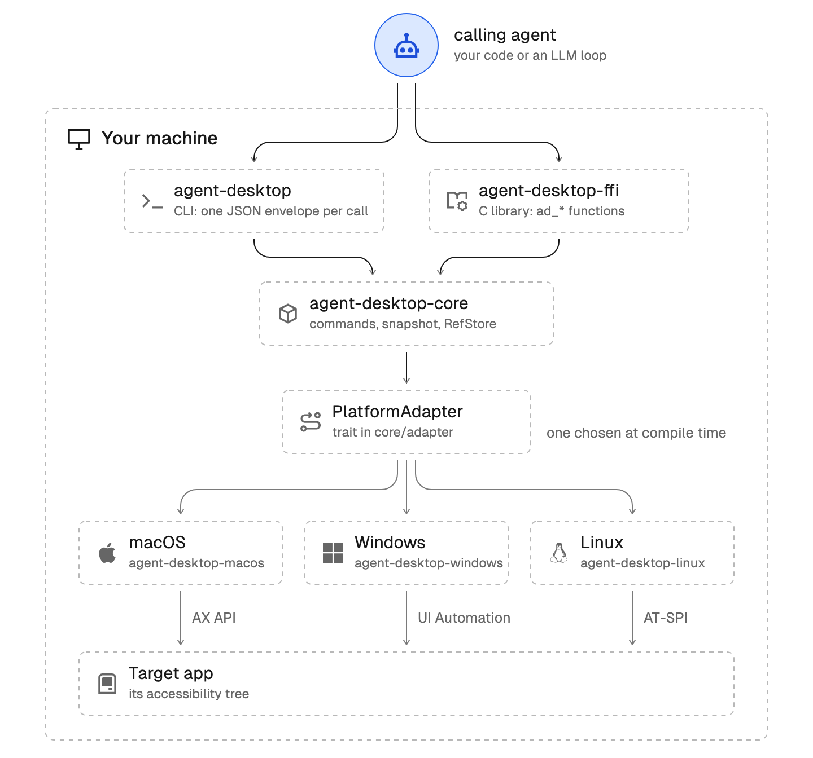

# agent-desktop

Computer use for AI agents: see and operate Windows desktop apps through UI Automation, without screenshots or pixel matching.

<p>
  <a href="https://vercel.com/labs#labs-products"></a>
  <a href="https://www.npmjs.com/package/agent-desktop"></a>
  <a href="https://github.com/vercel-labs/agent-desktop/blob/main/LICENSE"></a>
  <a href="https://www.npmjs.com/package/agent-desktop"></a>
</p>

agent-desktop gives an AI agent computer use without screenshots or pixel matching. It reads the accessibility tree of a desktop app and returns it as JSON, with a ref for every element the agent can act on. The agent clicks or types on a ref, reads the UI again to check the result, and repeats. The loop lives in your agent; agent-desktop has no model inside. It ships as a CLI and a C library.

Snapshots, clipboard reads, screenshots, command output, and debug artifacts can contain private desktop content. Keep them out of public logs and uploads.

## Install

```bash
npm install -g agent-desktop
agent-desktop status                # platform, permissions, supported surfaces
```

Bun, Yarn and pnpm can install the same package. It includes native Windows binaries for x64 and ARM64.
For direct execution without a JavaScript launcher, download the matching native archive from
[GitHub Releases](https://github.com/vercel-labs/agent-desktop/releases).

There is no Homebrew or Scoop package. The repository maintains neither a Homebrew tap nor a Scoop bucket.

Release archives and building from source are covered in [Installation](https://agent-browser.dev/desktop/installation).

## Quick start

```bash
agent-desktop launch notepad.exe            # start an app to drive
agent-desktop snapshot --app notepad.exe -i # interactive elements, each with a ref
agent-desktop click '@s8f3k2p9:e8'          # act on a ref from that snapshot
agent-desktop snapshot --app notepad.exe -i # observe again to verify
```

Each command prints one JSON envelope. A trimmed snapshot:

```json
{
  "version": "2.6",
  "ok": true,
  "command": "snapshot",
  "data": {
    "app": "notepad.exe",
    "snapshot_id": "s8f3k2p9",
    "ref_count": 59,
    "complete": true,
    "tree": {
      "role": "window",
      "name": "Downloads",
      "children": [
        { "role": "treeitem", "name": "Documents", "ref_id": "@s8f3k2p9:e8", "available_actions": ["Click"] }
      ]
    }
  }
}
```

- **Refs belong to their snapshot.** A bare `@e8` is rejected with `INVALID_ARGS`. When the UI changes, an action
  returns `STALE_REF` or `AMBIGUOUS_TARGET`: take a new snapshot and use its refs.
- **Several windows** give `AMBIGUOUS_TARGET`; `snapshot` lists the candidate window ids in `error.details`. Pass one
  with `--window-id`.
- **Dense apps:** map first with `snapshot --skeleton --app Slack -i --compact`, then drill into one region with
  `snapshot --root @s8f3k2p9:e3 -i --compact`.
- **Headless by default.** Ref actions use the accessibility API without moving the pointer or taking focus. The global
  `--headed` flag allows physical input.
- **Post-action waits** observe the ref's original process. Window-owned refs stay pinned to their original window,
  including refs captured from a sheet, alert, popover, or focused view. The wait reads the whole pinned window, so
  overlay selectors share its scope. [Wait scope and results](https://agent-browser.dev/desktop/configuration#post-action-wait-flags)
  describe the selector limits.
- `type`, `set-value`, and `clipboard-set` accept `--stdin` for piped text, keeping it out of process arguments. Run secret steps as separate commands; batch JSON text appears in process arguments.
- **PowerShell.** Quote every ref (`'@s8f3k2p9:e8'`), because a bare `@token` is the splatting operator.

The full walkthrough is in the [quick start](https://agent-browser.dev/desktop/quick-start).

## How it works

<picture>
  <source media="(prefers-color-scheme: dark)" srcset="assets/architecture-dark.png">
  
</picture>

Your agent calls the CLI, or the C library in process. Both run the same core, which reaches the OS only through `PlatformAdapter`, implemented by `agent-desktop-windows` on UI Automation.

## For AI agents

The binary carries guides that match its version:

```bash
agent-desktop skills get desktop      # the loop, refs, verification and retry rules
agent-desktop skills get platform     # what differs on the OS you run on
agent-desktop <command> --help        # flags for one command
```

Install the skill into an agent harness from [skills.sh](https://skills.sh/vercel-labs/agent-desktop/agent-desktop):

```bash
npx skills add https://github.com/vercel-labs/agent-desktop --skill agent-desktop
```

Or add this to your `AGENTS.md`:

```markdown
Use `agent-desktop` to see and operate desktop apps. Before the first use, run
`agent-desktop skills get desktop` and `agent-desktop skills get platform`, and follow them.
```

Retry a failed command only when `error.disposition.retry` is `safe`. See [JSON output](https://agent-browser.dev/desktop/json-output) for the envelope, error codes, and exit codes.

### MCP

`agent-desktop mcp` serves every command as an MCP tool over stdio. A tool is named after its command (`desktop_snapshot`, `desktop_click`, `desktop_session_start`), takes that command's arguments, and returns its JSON envelope:

```json
{ "mcpServers": { "agent-desktop": { "command": "agent-desktop", "args": ["mcp"] } } }
```

Global flags given to `mcp`, such as `--session`, `--headed` or `--trace`, apply to every call except `sandbox exec`, whose guest command takes its own flags.

## Commands

agent-desktop has 61 command names, 57 operational commands. The other four (`key-down`, `key-up`, `mouse-down`, `mouse-up`) refuse to run until a daemon can release a held key or button. [Commands](https://agent-browser.dev/desktop/commands) documents each one.

| Group | Commands |
|---|---|
| Observe | `snapshot`, `find`, `get`, `is`, `screenshot`, `list-surfaces` |
| Act on a ref | `click`, `double-click`, `triple-click`, `right-click`, `type`, `set-value`, `clear`, `focus`, `select`, `toggle`, `check`, `uncheck`, `expand`, `collapse`, `scroll`, `scroll-to` |
| Keyboard and mouse | `press`, `hover`, `drag`, `mouse-move`, `mouse-click`, `mouse-wheel`, `key-down`, `key-up`, `mouse-down`, `mouse-up` |
| Apps and windows | `launch`, `close-app`, `list-apps`, `list-windows`, `list-displays`, `focus-window`, `resize-window`, `move-window`, `minimize`, `maximize`, `restore`, `open-system-surface` |
| Notifications | `list-notifications`, `dismiss-notification`, `dismiss-all-notifications`, `notification-action` |
| Clipboard | `clipboard-get`, `clipboard-set`, `clipboard-clear` |
| Wait | `wait` |
| Sessions | `session`, `trace`, `cursor-overlay` |
| Sandboxes | `sandbox` |
| System | `status`, `permissions`, `version`, `batch`, `skills` |

## Platform support

| Platform | Requirement | Accessibility API |
|---|---|---|
| [Windows](https://agent-browser.dev/desktop/platforms/windows) | Windows 10 1809 or later, x64 or ARM64 | UI Automation |

The platform page lists what works headless, what needs `--headed`, and what refuses.

## C library

Each release ships `libagent_desktop_ffi`, so a program can call agent-desktop in process. See the [C library docs](https://agent-browser.dev/desktop/ffi).

```python
import ctypes
lib = ctypes.CDLL("./agent_desktop_ffi.dll")
lib.ad_adapter_create.restype = ctypes.c_void_p
lib.ad_adapter_destroy.argtypes = [ctypes.c_void_p]
assert lib.ad_init(7) == 0  # AD_RESULT_OK when the header's AD_ABI_VERSION_MAJOR matches the library
adapter = lib.ad_adapter_create()
lib.ad_adapter_destroy(adapter)
```

## Development

The workspace builds on Windows only:

```powershell
cargo test --workspace
cargo clippy --workspace --all-targets -- -D warnings
```

[CONTRIBUTING.md](CONTRIBUTING.md) lists every gate.

## Documentation

- [Introduction](https://agent-browser.dev/desktop): what it is and how it works
- [Snapshots and refs](https://agent-browser.dev/desktop/snapshots-and-refs)
- [Errors and recovery](https://agent-browser.dev/desktop/errors-and-recovery)
- [Skills](https://agent-browser.dev/desktop/skills)
- [CONCEPTS.md](CONCEPTS.md): vocabulary
- [CONTRIBUTING.md](CONTRIBUTING.md), [SECURITY.md](SECURITY.md), [SUPPORT.md](SUPPORT.md)

## License

Apache-2.0
